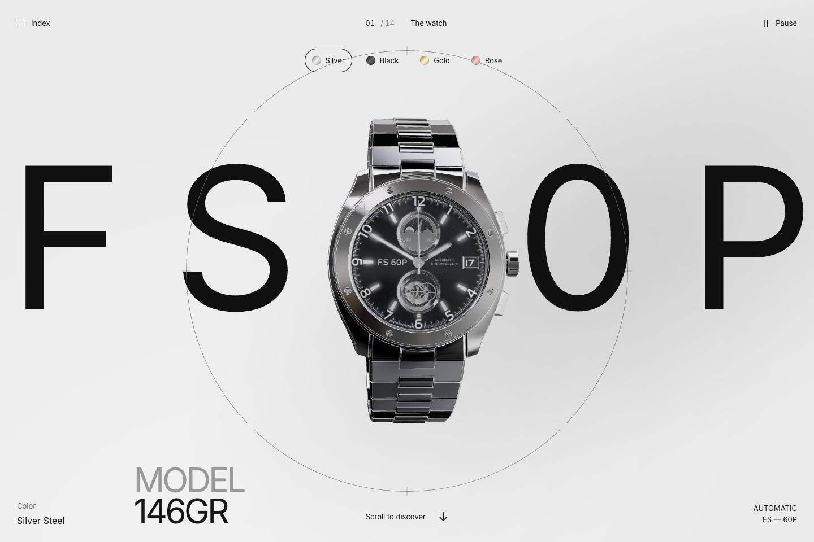

# The Watch



An interactive watch presentation with a continuous 3D scene, scroll-driven camera movement, a mechanical assembly view, finish selection, and an illustrated parts catalogue.

[Open the live experience](https://dearyour.github.io/the-watch/)

## Run

Requires Node.js 22.12 or newer.

```sh
npm install
npm run dev -- --port 5173
```

```sh
npm run typecheck
npm run build
npm run preview
```

The production output is generated in `dist/`. Relative asset paths support static hosting at a domain root or subdirectory.

## Deploy

GitHub Pages publishes the site at https://dearyour.github.io/the-watch/.
Every push to `main` builds the application and deploys `dist/` through the
`Deploy to GitHub Pages` workflow. It can also be started manually from Actions.
The repository's Pages source is set to **GitHub Actions**.

## Explore

Scroll to move through 14 chapters. The index jumps to any scene. Select a metal finish, separate and inspect the mechanism, or open a component in the catalogue. Pause stops ambient movement; system reduced-motion preferences use stationary chapter viewpoints.

## Technology

Vanilla TypeScript, Vite, Three.js, and locally bundled Inter typography. Responsive layouts include keyboard controls and reduced-motion support.

Artwork and dependency credits are listed in [THIRD_PARTY_NOTICES.md](THIRD_PARTY_NOTICES.md).
